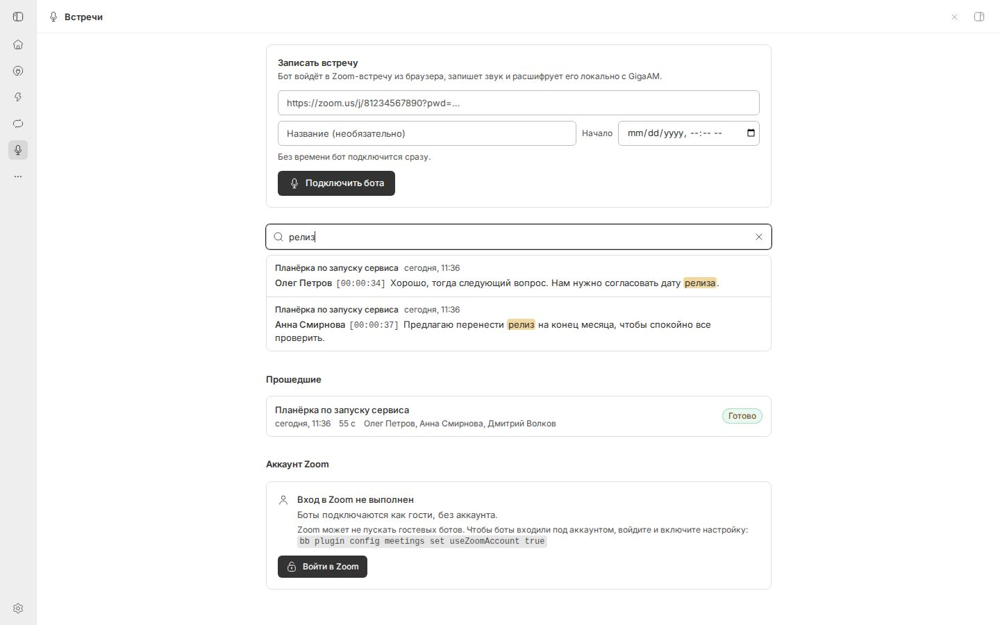
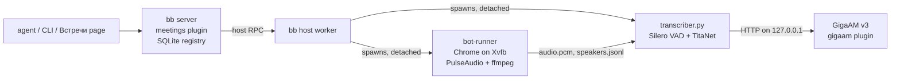

# Meetings for bb

**A multi-platform notetaker for [bb](https://getbb.app) with local Russian transcription by [GigaAM v3](https://github.com/salute-developers/GigaAM).**

Give an agent a Zoom, Google Meet, Telemost or Jitsi link. A bot named "Notetaker" joins through the platform’s browser client, records it, and transcribes it while the meeting runs. The transcript is split by speaker and named after the Zoom participants. Recording, speech recognition and storage all run on your machine, with no Zoom API keys or cloud transcription service. Agents can still read the transcripts; see [Privacy](#privacy).

[](./LICENSE)
[](https://getbb.app)
[](https://github.com/salute-developers/GigaAM)

The full user guide is in Russian: [docs/guide.ru.md](docs/guide.ru.md).


| While the meeting runs | Live transcript, split by speaker |
|---|---|
|  |  |
| **The bot's live view** (the lit tile is the current speaker) | **A real Zoom meeting through the bot's eyes** |
|  |  |
| **Full-text search across all meetings** | **The bot's avatar as its camera** |
|  |  |
| **Bot name and avatar** | **Google Calendar setup** |
|  |  |

Screenshots show a demo meeting played by the plugin's built-in mock meeting (three Russian TTS voices), plus a real Zoom test meeting.

## Features

- **Join from a link.** Ask an agent ("Запиши встречу https://zoom.us/j/…"), run `bb meetings join`, or paste the link on the **Встречи** page. You can also give a start time. Within about a minute the agent reports whether the bot got in, is waiting to be admitted, or failed and why.
- **Live transcript.** GigaAM v3 transcribes the audio during the meeting. The final transcript is usually ready 1–3 minutes after the bot leaves.
- **Speakers by name.** The bot uses Zoom's own active-speaker state, the highlighted video tile and per-participant WebRTC audio tracks. Voice embeddings (TitaNet) fill the gaps. You can rename any speaker.
- **Deaf-bot guard.** If the meeting shows people speaking but the bot records silence (the platform did not deliver the audio), or the participants' audio reaches the bot but not the recording, the bot notices within about 45 seconds and fixes it by itself: it rejoins the meeting audio, then reloads the meeting page and joins again, while the recording keeps running. If that does not help, the Meetings page shows «Бот не слышит участников встречи» (or «Бот слышит участников, но звук не попадает в запись») with what was tried, and the agent thread that started the recording gets one message.
- **Live view and remote control.** Watch the bot's browser from the page, and click or type into it to solve a captcha or an unexpected dialog.
- **Browser account sign-in.** Connect separate Zoom, Google and Yandex profiles for meetings that require authentication. Each call uses its own profile copy.
- **Google Calendar auto-join (OAuth).** Connect your Google account on the Meetings page with your own OAuth client, and pick the calendars to watch. The bot then joins every event that has a supported meeting link, a minute before it starts, and leaves when the call ends. Any other calendar works through its secret iCal (ICS) address.
- **Bot name and avatar.** Set the name participants see, and upload an avatar. The bot turns on its camera and shows the avatar in a circle with its name, instead of a blank tile.
- **Search, summaries, downloads.** Full-text search across all meetings, agent-written Markdown summaries, and downloads as md, txt, srt, vtt, json or the Opus audio.
- **Templates and analysis.** Five built-in templates, editable custom rules, decisions, tasks with completion state, risks, chapters, follow-up drafts and speech metrics. Every analysis keeps the exact rules used.
- **Meeting Q&A.** Ask about one or multiple recordings; API answers cite actual transcript segments and timecodes. Agent mode returns instructions to the connected BB agent instead of pretending it has generated an answer.
- **MCP, REST and webhooks.** Authenticated external-agent endpoints, rotatable personal tokens and HMAC-signed completion events with the final transcript. See [Notetaker integrations](docs/notetaker.ru.md).
- **Import.** `bb meetings import <file>` transcribes an existing audio or video recording.

Full settings, templates, browser accounts and external-agent connection details are under **Настройки** on the Meetings page. [New functions and setup](docs/notetaker.ru.md).

## Google Calendar setup

Google Calendar is read through your own OAuth client, which is free and takes one setup:

1. In [Google Cloud Console](https://console.cloud.google.com), enable the **Google Calendar API**.
2. Configure the **OAuth consent screen**: External, with your account as a test user. Publish the app: in *Testing*, Google expires the access after 7 days.
3. Create an **OAuth client ID** of type **Web application**. Its authorized redirect URI is the bb address plus `/api/v1/plugins/meetings/http/google/callback`. The **Google Календарь** card on the Meetings page shows the exact URI with a copy button.
4. Paste the Client ID and Secret into the card, click **Подключить Google Календарь**, allow read access, and tick the calendars to watch.

Step-by-step instructions in Russian: [docs/guide.ru.md §8.1](docs/guide.ru.md).

## Requirements

| | |
|---|---|
| bb | 0.46 or newer |
| OS | Linux x86-64 or arm64 on bb's primary host. Tested on Ubuntu 24.04 x86-64. |
| Browser | Google Chrome (Chromium on arm64) |
| System packages | Xvfb, PulseAudio with `pactl`, ffmpeg with libopus. xdotool is optional but recommended. |
| Speech recognition | The [`gigaam`](https://github.com/AiXenix/bb-plugin-gigaam) bb plugin, or any OpenAI-compatible `/v1/audio/transcriptions` server (setting `gigaamUrl`) |
| Plugin runtime | Installed by `bb meetings setup`: uv, a Python 3.12 venv with sherpa-onnx, playwright-core, and about 45 MB of models (Silero VAD v5, TitaNet small). About 0.3 GB in total. |
| Disk | About 15 MB per hour of Opus audio, plus about 115 MB per hour of temporary PCM while a meeting is transcribed |
| RAM | About 0.5–1 GB per bot (Chrome) and about 250 MB per transcriber |

Transcription is Russian only. Supported meeting platforms are Zoom, Google Meet, Yandex Telemost and Jitsi. For a self-hosted Jitsi URL pass `--platform jitsi`. Admission still depends on the service and meeting organizer.

## Install

Meetings needs the [GigaAM plugin](https://github.com/AiXenix/bb-plugin-gigaam) for speech recognition:

```sh
bb plugin install git:https://github.com/AiXenix/bb-plugin-gigaam@^0.1.0     # GigaAM v3 (wait for: bb gigaam status → ready)
bb plugin install 'git:https://github.com/AiXenix/bb-plugin-meetings@^0.3.0'
```

Or install a local checkout with `bb plugin install /path/to/bb-plugin-meetings`.

The plugin uses BB-managed settings, storage and host paths. It does not require
a particular server address or external bot. The optional adapters in
`integrations/` connect existing agents; the MCP stdio adapter needs only Node.js
and a BB CLI that already has access to your BB. The recorder runs on a supported
Linux host, while BB's browser interface can be used from any client.

Then check the recording machine and install what is missing:

```sh
bb meetings doctor      # what is installed, what is missing, and how to fix it
bb meetings setup       # install the missing pieces in the background
bb meetings doctor      # repeat until it says "ready"
bb meetings selftest    # record the built-in mock meeting (no Zoom needed)
```

`setup` installs apt packages itself only when bb's user has passwordless `sudo`. Otherwise `doctor` prints the command to run. The **Установить компоненты** button on the Встречи page does the same as `setup`.

## Quick start

```sh
bb meetings join "https://us02web.zoom.us/j/81234567890?pwd=…" --title "Планёрка" --wait 60s
bb meetings list --status active
bb meetings transcript <id>
bb meetings stop <id>
```

Or tell an agent in any bb thread: *«Запиши встречу https://us02web.zoom.us/j/81234567890?pwd=…»*. The agent calls `meetings_join`. When the meeting ends, the thread gets a message, and by default the agent writes a summary (decisions, action items, open questions) and saves it to the meeting card.

If the meeting has a waiting room, the host must admit **Notetaker** (setting `botName`).

## How it works



1. The server side of the plugin keeps the meeting registry in SQLite, schedules bots, and serves the page, the CLI and the agent tools.
2. The host entry runs on bb's primary machine. It installs the runtime and starts two **detached** processes per meeting, which survive plugin reloads and bb restarts.
3. The bot runner starts a private Xvfb display and PulseAudio sinks, then opens the Zoom web client (`app.zoom.us/wc/<number>/join`) in Chrome. It joins with the camera off and a silent microphone, and ffmpeg records what Chrome plays.
4. The transcriber reads the audio as it is written, cuts it into speech pieces with Silero VAD, sends each piece to GigaAM, and assigns a speaker.
5. All state lives in files under `~/.bb/plugins/meetings/host-data/meetings/<id>/`: `audio.ogg`, `speakers.jsonl`, `segments.jsonl`, `transcript.json`/`.md`/`.txt`, `state.json` and logs. The server polls them and copies segments into its database for search.

## Speaker detection

Zoom sends one mixed audio stream to the browser, so the bot works out who is talking from four signals:

1. **Zoom's state.** The web client's Redux store holds the active speaker ids and the participant list with names. This signal does not depend on CSS classes.
2. **The highlighted tile.** The speaking participant's video tile lights up, with the name under it. It is a fallback because it lags 1–2 s and sticks.
3. **Per-participant audio tracks.** Zoom in Chrome usually sends one WebRTC audio track per participant. The bot measures each track's loudness and learns which name it belongs to. This gives exact speech times, including overlaps.
4. **Voices.** After the meeting, a TitaNet embedding is computed for each speech piece and the pieces are clustered. Clusters take names from signals 1–3, so pieces without a Zoom signal still get a name. If Zoom gave no names at all, speakers are labelled "Спикер 1", "Спикер 2", and so on.

The `diarization` setting picks the mode: `ui+acoustic` (default), `ui` (Zoom signals only) or `acoustic` (voices only). Rename a speaker on the page, with `bb meetings rename-speaker <id> "Спикер 2" "Ольга Ким"`, or through an agent. Renames of Zoom-named speakers survive re-transcription, but "Спикер N" numbers can change, so check those renames after `bb meetings retranscribe`.

## Agent tools

| Tool | What it does |
|---|---|
| `meetings_join` | Send the bot to a meeting now or at a given time, and wait up to 60 s for the outcome |
| `meetings_status` | One meeting, or the active, upcoming and recent ones |
| `meetings_stop` | Make the bot leave |
| `meetings_transcript` | Read a transcript, paged by segment id |
| `meetings_search` | Full-text search across all transcripts |
| `meetings_save_summary` | Save a Markdown summary to the meeting card |
| `meetings_rename_speaker` | Rename a speaker in one meeting |

Agents learn the workflow and the error codes from the bundled `meeting-bb-aixenix` skill ([`skills/meeting-bb-aixenix/SKILL.md`](skills/meeting-bb-aixenix/SKILL.md)). It also covers GigaAM checks, since every transcript depends on it.

## External agents

Agents outside bb (for example an OpenClaw bot that drives the bb CLI from another machine) use one JSON entry point:

```sh
echo '{"action":"transcript","id":"mtg_…","fromSegment":0}' | bb meetings api --request-stdin --json
```

Actions: `list`, `show`, `join`, `stop`, `cancel`, `delete` (needs `confirm: true` and the user's request), `transcript` (paged), `search`, `summary`, `save_summary`, `rename_speaker`, `retranscribe`, `logs`, `doctor`, `calendar`. Passcodes are masked in every answer. Field reference: [docs/guide.ru.md](docs/guide.ru.md) §5 «Внешние агенты».

## Commands

| Command | What it does |
|---|---|
| `bb meetings join <url> [--title T] [--name N] [--at 15:00\|ISO] [--max-duration 2h] [--wait 60s] [--no-notify]` | Send the bot, now or later |
| `bb meetings list [--status active\|upcoming\|past\|<status>] [--limit N]` | List meetings |
| `bb meetings show <id>` | Status, participants, speakers, errors |
| `bb meetings stop <id>` / `cancel <id>` | Make the bot leave / cancel a scheduled meeting |
| `bb meetings transcript <id> [--format md\|txt\|srt\|vtt\|json] [--from N] [--limit N]` | Print a transcript |
| `bb meetings search <words>` | Search all transcripts |
| `bb meetings rename-speaker <id> <key\|label> <name>` | Rename a speaker |
| `bb meetings summary <id> [--set MD \| --clear]` | Print or save the summary |
| `bb meetings retranscribe <id>` | Transcribe the recorded audio again |
| `bb meetings delete <id> --yes` | Delete a meeting with its recording and transcript |
| `bb meetings import <file> [--title T]` | Transcribe an existing audio or video file |
| `bb meetings logs <id>` / `screenshot <id>` / `debug-dump <id>` | Troubleshoot a bot |
| `bb meetings calendar [sync]`, `calendar skip\|unskip <key>` | Calendar auto-join |
| `bb meetings google [sync\|disconnect]` | Google Calendar connection (connect on the Meetings page) |
| `bb meetings bot [--name] [--show-avatar on\|off] [--avatar <file>] [--clear-avatar]` | The bot's name and avatar |
| `bb meetings zoom-login` / `zoom-logout` / `zoom-status` | The bot's Zoom account |
| `bb meetings doctor` / `setup [--force]` / `selftest` | Check and install the runtime |

Every command has `--help`, and most have `--json`.

## Settings

Edit them on the Meetings plugin's settings page in bb, or with `bb plugin config meetings set <key> <value>`.

| Key | Default | Meaning |
|---|---|---|
| `botName` | `Notetaker` | Name shown in the meeting |
| `showAvatar` | `true` | Show the uploaded avatar as the bot's camera |
| `maxDurationMinutes` | `240` | Hard stop, 5–1440 minutes |
| `aloneTimeoutMinutes` | `2` | Leave after being alone this long |
| `waitingTimeoutMinutes` | `20` | How long to wait for the host or in the waiting room |
| `silenceTimeoutMinutes` | `30` | Leave after this long with no audio at all; `0` never |
| `maxConcurrentBots` | `2` | Parallel recordings, 1–8 |
| `chatAnnouncement` | empty | Chat message the bot posts after joining |
| `notifyThread` | `true` | Message the agent thread that started the meeting when it ends |
| `autoSummaryPrompt` | Russian summary request | Request appended to that message; empty sends only the notice |
| `liveTranscription` | `true` | Transcribe during the meeting |
| `diarization` | `ui+acoustic` | `ui+acoustic`, `ui` or `acoustic` |
| `speakerLagMs` | `700` | Shifts every speaker signal relative to its default lag (track 100, store 700, tile 1200 ms): 1000 = everything 0.3 s later. Per-signal lags: `speakerSelectors.lagMs`. |
| `gigaamUrl` | empty | ASR server; empty finds the `gigaam` plugin's server |
| `keepRawAudio` | `false` | Keep `audio.pcm` after transcription |
| `screenshotIntervalSec` | `10` | Screenshot interval while nobody watches the live view |
| `useZoomAccount` | `false` | Join with the signed-in Zoom profile (`bb meetings zoom-login`) |
| `speakerSelectors` | empty | Advanced JSON override of the speaker-detection selectors and lags, for example `{"lagMs":{"store":900}}` |
| `chromePath` | empty | Chrome binary; empty auto-detects |
| `calendarIcsUrls` | none | Secret ICS addresses, separated by spaces (stored as a secret) |
| `calendarAutoJoin` | `false` | Join Zoom meetings from the calendars |
| `calendarLeadMinutes` | `1` | Join this many minutes early |
| `calendarOvertimeMinutes` | `60` | Calendar meetings record at most the event length plus this (0 = no cap) |
| `calendarFilter` | empty | Title substring, or `/regex/` in slashes |
| `calendarSyncMinutes` | `5` | How often to re-read the calendars |
| `googleClientId` | empty | Your Google OAuth client (Web application) for Google Calendar |
| `googleClientSecret` | — | Its secret (stored as a secret setting) |

## Limits

- **Length.** 4 hours by default (`maxDurationMinutes`), at most 24 hours. Zoom itself closes meetings hosted on a free (Basic) account after 40 minutes. If the host restarts the meeting, send the bot again.
- **Parallel meetings.** `maxConcurrentBots`, 2 by default. Each bot is a separate Chrome.
- **Language.** GigaAM v3 recognizes Russian only. English speech comes out garbled.
- **Admission.** Zoom may keep the bot in the waiting room, refuse guests (`auth_required`), show its bot wall (`bot_blocked`) or a captcha, or require webinar registration. Signing the bot in to a Zoom account solves most of these. The host can also disable joining from a browser, which cannot be bypassed.
- **Speed.** GigaAM transcribes an hour of speech in about 6–7 minutes of CPU. Live transcription keeps up with the meeting.

## Privacy

- **Audio stays local.** Recording, speech recognition (the `gigaam` plugin on `127.0.0.1`, unless you point `gigaamUrl` at another machine), speaker detection and storage all run on your machine. The bot talks only to Zoom.
- **Agents send transcripts to their model provider.** Results of the meetings tools go to the AI model provider of the agent thread, like any other tool result: transcript text from `meetings_transcript`, search hits from `meetings_search`, participant names from `meetings_status`. Summaries are written by that model. This happens **automatically** after every meeting started from an agent thread: by default the plugin posts a message to the thread and asks the agent to read the whole transcript and summarize it.
- **Keeping everything local.** Disable automatic analysis (`autoSummarize`) and configured webhooks. Start meetings from the Встречи page or a terminal, which notifies no thread. For agent-started meetings, run `bb plugin config meetings set notifyThread false` (or `bb meetings join --no-notify`), or empty `autoSummaryPrompt` so the thread gets only a short notice. Calendar auto-join notifies no thread.
- **Consent.** The bot is visible to every participant. Tell participants they are being recorded; in many countries the law requires their consent. Set `chatAnnouncement` to post a notice in the meeting chat.
- **Deleting.** `bb meetings delete <id> --yes` removes the recording, the transcript and the summary. A Zoom sign-in profile stays in `host-data/profiles/zoom` until `bb meetings zoom-logout`.

## Troubleshooting

- **The bot does not get in.** Read the status on the page and open the live view. Then check `bb meetings logs <id>` and `bb meetings screenshot <id>`.
- **The transcript waits for GigaAM.** Run `bb gigaam status`, and `bb gigaam restart` if the server is down. The transcriber resumes by itself.
- **The recording is silent.** Run `bb meetings doctor` (PulseAudio) and `bb meetings selftest`. If the page warned «Бот не слышит участников встречи», the platform did not send the bot any audio («Бот слышит участников, но звук не попадает в запись»: it did, but the audio did not reach the recording); `bb meetings logs <id>` shows what the bot tried (lines starting with `Deaf bot`).
- **Speakers show as "Неизвестный" or "Спикер N".** Zoom showed no active speaker, for example during screen sharing. Rename the speakers. If it happens in every meeting, run `bb meetings debug-dump <id>` during a meeting and look at the `debug/` folder.
- **Plugin logs.** `bb plugin logs meetings -n 200`.

## Uninstall

Removing the plugin does **not** stop bots that are already in a meeting: they are detached processes. Stop them first:

```sh
bb meetings list --status active      # stop each one: bb meetings stop <id>
bb meetings list --status upcoming    # cancel each one: bb meetings cancel <id>
bb meetings list --status active      # repeat until nothing is left
bb meetings zoom-logout               # optional: delete the bot's Zoom sign-in
bb plugin remove meetings
rm -rf ~/.bb/plugins/meetings         # recordings, transcripts, runtime (about 0.3 GB plus recordings)
```

## Development

```sh
npm install
npm test                 # vitest: server, host, app
npm run test:bot         # bot runner unit tests (node --test)
npm run test:py          # transcriber tests (needs a venv with sherpa-onnx in .e2e/venv)
npm run e2e:bot          # bot runner + transcriber against the mock meeting page
npm run typecheck
npm run build            # bb plugin build
bb plugin install .      # run your working copy in bb
```

`runtime/` (bot runner, transcriber, mock meeting) is embedded into the host bundle, so run `npm run embed` after you edit it. The design and file contracts are in [docs/dev/DESIGN.md](docs/dev/DESIGN.md) and `src/shared/`.

## Credits

- [GigaAM](https://github.com/salute-developers/GigaAM) by SberDevices, MIT license
- [sherpa-onnx](https://github.com/k2-fsa/sherpa-onnx) (Silero VAD, NeMo TitaNet speaker embeddings)
- [Playwright](https://playwright.dev) (playwright-core)
- [uv](https://github.com/astral-sh/uv) by Astral
- [bb](https://getbb.app) plugin SDK

## License

[MIT](./LICENSE). © 2026 [AiXenix](https://aixenix.com)
