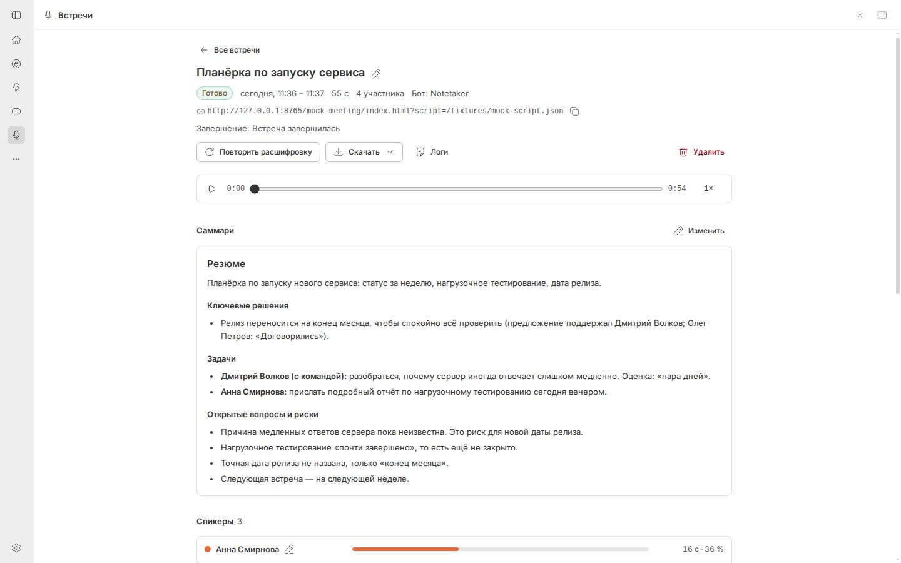
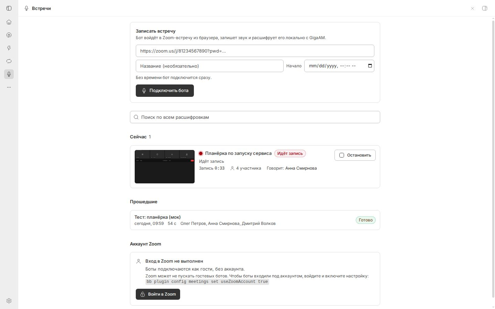
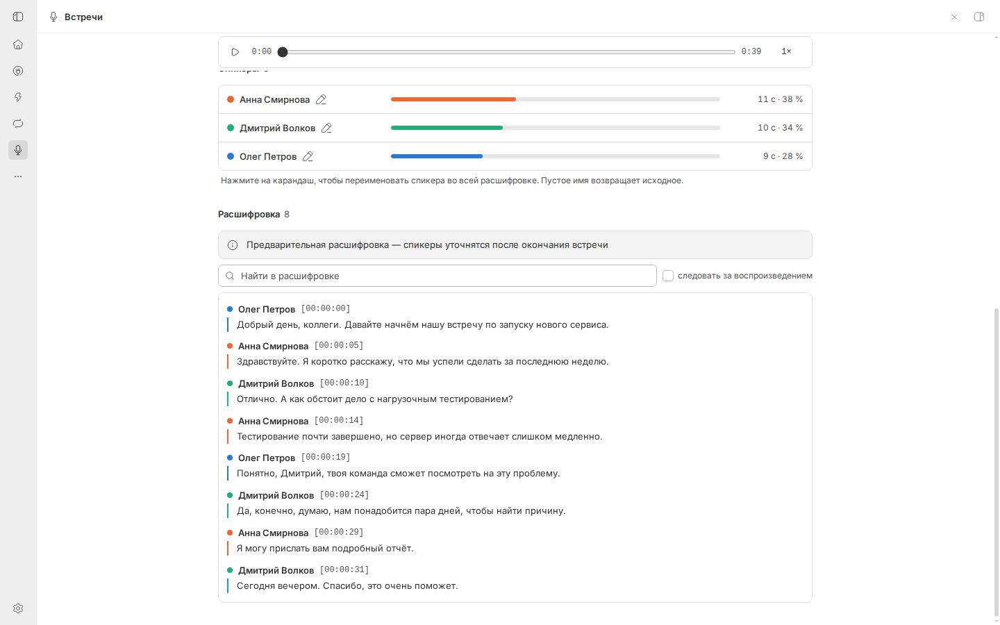
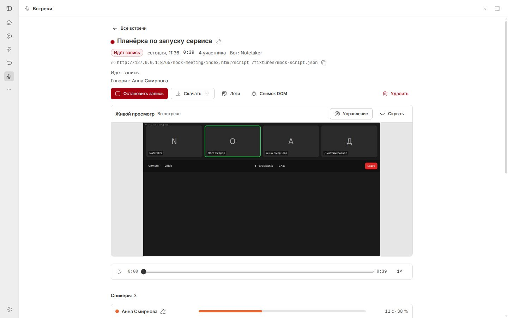
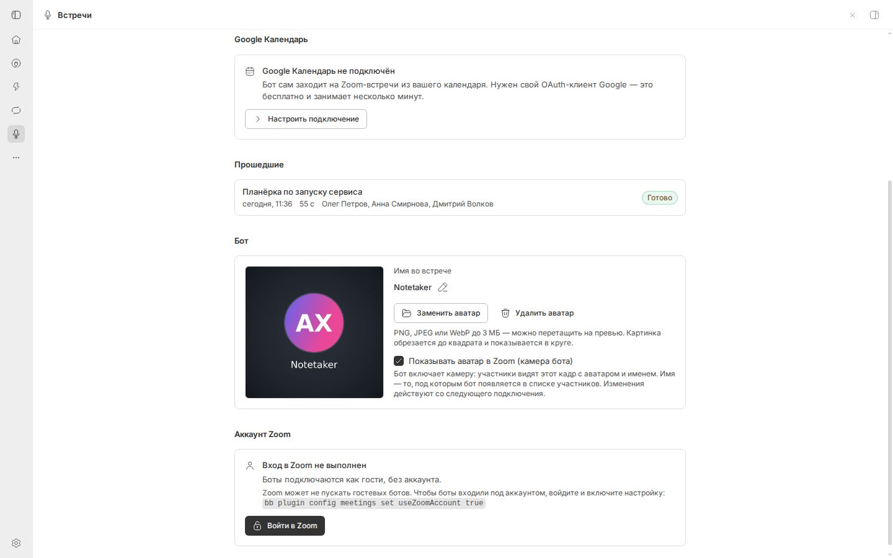
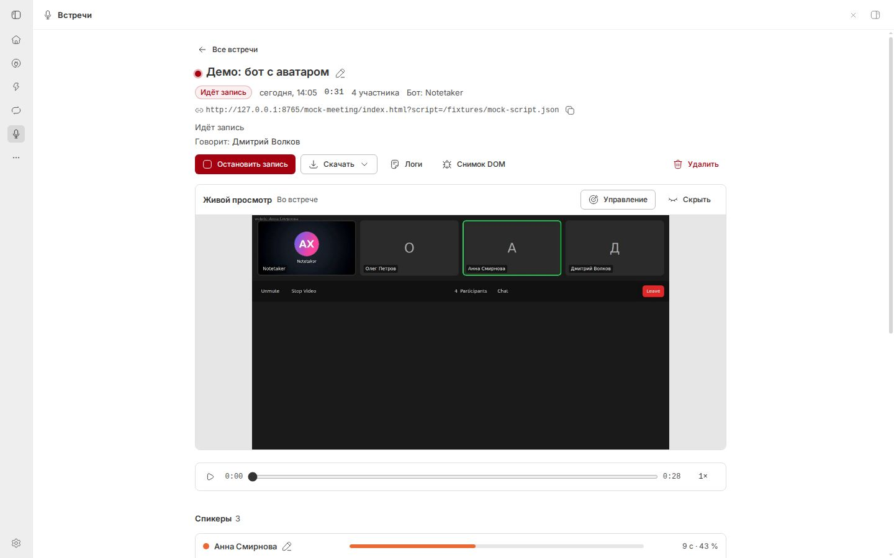
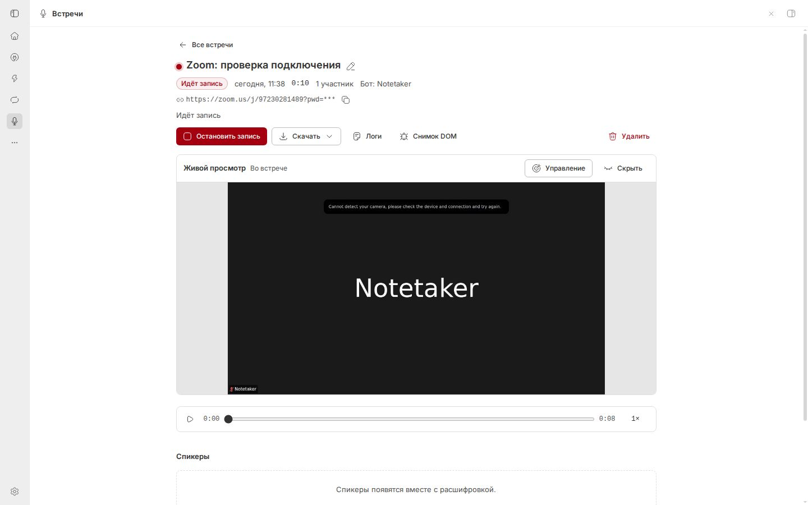
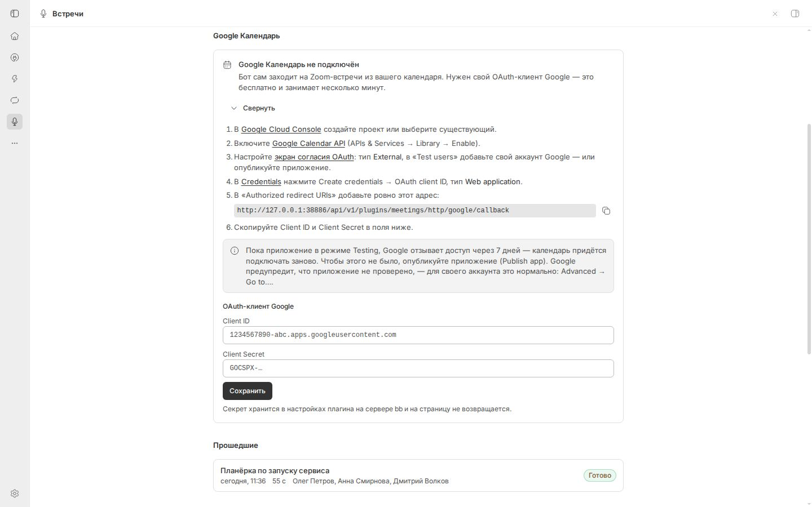

# «Встречи» — бот-стенографист для Zoom, Google Meet, Телемоста и Jitsi в bb

Плагин `meetings` для bb работает как Fireflies или Otter. Вы даёте агенту ссылку на Zoom, Google Meet, Телемост или Jitsi, и бот подключается к ней как участник «Notetaker». Он записывает звук и следит, у кого из участников загорается индикатор речи. Звук сразу расшифровывается локальной моделью **GigaAM v3** (плагин `gigaam`), а текст делится по спикерам. Все встречи собраны на вкладке **«Встречи»** в боковой панели bb. Там есть живой просмотр, плеер, расшифровка, поиск и саммари.

Звук не уходит в сторонние сервисы: бот, распознавание речи и хранение работают на вашей машине, а сам бот подключается к выбранному сервису встреч. Но текст расшифровки уходит к поставщику ИИ-модели агента всякий раз, когда агент его читает. По умолчанию это происходит автоматически после каждой встречи, запущенной из треда агента: плагин просит агента прочитать расшифровку и сделать саммари. Подробности и как оставить всё на машине — в разделе 11.



---

## 1. Быстрый старт

### 1.1. Установить плагин

Нужны два плагина: распознавание речи [GigaAM](https://github.com/AiXenix/bb-plugin-gigaam) и сами [«Встречи»](https://github.com/AiXenix/bb-plugin-meetings). Вместе со «Встречами» приходит скилл для агентов `meeting-bb-aixenix`.

```sh
# 1) распознавание речи GigaAM v3
bb plugin install git:https://github.com/AiXenix/bb-plugin-gigaam@^0.1.0
bb gigaam status            # дождаться ready (первая установка — несколько минут)

# 2) «Встречи»
bb plugin install git:https://github.com/AiXenix/bb-plugin-meetings@^0.3.0
```

Из локальной копии: `bb plugin install /путь/к/bb-plugin-meetings`.

### 1.2. Проверить и доустановить компоненты

Боту нужны Google Chrome, Xvfb (виртуальный экран), PulseAudio (виртуальный звук) и ffmpeg. Транскриберу нужны Python-окружение с `sherpa-onnx` и две модели: VAD (детектор речи) и эмбеддинги голоса, всего около 45 МБ.

```sh
bb meetings doctor      # что есть, чего нет и как починить
bb meetings setup       # доустановить недостающее (идёт в фоне)
bb meetings doctor      # повторять, пока не будет "ready"
bb meetings selftest    # пробная запись встроенной тестовой встречи, без Zoom
```

То же, что `setup`, делает кнопка **«Установить компоненты»** на вкладке «Встречи». Системные пакеты (`apt-get`) ставятся сами, только если у пользователя bb есть `sudo` без пароля. Иначе `doctor` покажет команду, которую нужно выполнить вручную.

`selftest` проверяет всю цепочку на встроенной имитации Zoom-встречи: Chrome, PulseAudio, ffmpeg, определение спикеров и транскрибер.

### 1.3. Записать встречу

Выберите любой способ:

- **Через агента.** Напишите в любом треде bb: *«Запиши встречу https://us02web.zoom.us/j/81234567890?pwd=…»*. Агент вызовет инструмент `meetings_join` и примерно за минуту ответит, удалось ли войти. Например: «бот во встрече», «бот в зале ожидания, впустите Notetaker» или причина неудачи.
- **На вкладке «Встречи».** Вставьте ссылку в поле «Записать встречу» и нажмите **«Подключить бота»**. Чтобы бот подключился позже, укажите время.
- **Из терминала.** Выполните `bb meetings join "https://zoom.us/j/81234567890?pwd=…" --title "Планёрка"`.

Если во встрече включён **зал ожидания**, организатору нужно впустить участника **Notetaker** (имя меняется настройкой `botName`).

### 1.4. Во время встречи

На вкладке «Встречи» в разделе **«Сейчас»** видно:

- статус бота;
- снимок экрана бота;
- сколько участников во встрече и кто говорит прямо сейчас;
- **предварительную расшифровку**, которая пополняется по ходу встречи.

Остановить запись можно кнопкой **«Остановить запись»**, командой `bb meetings stop <id>` или просьбой к агенту. Сам бот уходит, когда:

- организатор завершил встречу или удалил бота;
- бот остался во встрече один дольше `aloneTimeoutMinutes` (по умолчанию 2 мин);
- запись длится дольше `maxDurationMinutes` (по умолчанию 240 мин);
- в эфире полная тишина дольше `silenceTimeoutMinutes` (по умолчанию 30 мин).

**Если бот не слышит участников.** Бывает, что платформа (так было в Zoom) показывает боту, кто говорит, но не отдаёт ему звук: в записи остаётся полная тишина. Бывает и наоборот: звук до бота доходит (его слышно на дорожках участников), но в запись не попадает. Бот замечает и то и другое примерно за 45 секунд и сам пробует вернуть звук: дважды переподключает звук встречи (в Zoom — «Leave Computer Audio» и снова «Join Audio», заодно выбирает динамик по умолчанию), затем перезагружает страницу встречи и входит заново. Запись при этом не прерывается. Если включён зал ожидания, после перезагрузки организатору нужно снова впустить бота — об этом скажет предупреждение. Пока бот пытается, на карточке встречи видно жёлтое предупреждение: «Бот не слышит участников встречи…» или «Бот слышит участников, но звук не попадает в запись…». Если ничего не помогло, в предупреждении написано, что пробовали, бот продолжает переподключать звук каждые 3 минуты, а в тред агента, запустившего запись, приходит одно сообщение. Пока участники говорят, бот не уходит по тишине. Когда звук появляется в записи, предупреждение исчезает само. Тихая встреча, демонстрация экрана с одним «залипшим» говорящим и бот, оставшийся один, предупреждения не вызывают.





### 1.5. После встречи

Окончательная расшифровка обычно готова через 1–3 минуты после ухода бота. Бо́льшая часть текста распознаётся ещё во время встречи, после неё остаётся только уточнить спикеров. Если встречу запустил агент, в его тред придёт сообщение «встреча завершена». По умолчанию агент сразу делает **саммари**: решения, задачи с ответственными и сроками, открытые вопросы. Он сохраняет его в карточку встречи инструментом `meetings_save_summary`. Для этого агент читает всю расшифровку, то есть её текст уходит к поставщику модели агента (раздел 11).

---

## 2. Как это устроено

```
 ссылка ─► агент / CLI / вкладка ─► сервер bb (плагин meetings): реестр встреч, планировщик
                                        │
                                        ▼ host RPC
                            host-воркер bb на этой машине
                    ┌───────────────────┴────────────────────┐
                    ▼                                        ▼
       bot-runner (Node, отдельный процесс)     transcriber.py (отдельный процесс)
       Xvfb + Google Chrome → веб-клиент Zoom   читает audio.pcm «на лету»
       PulseAudio: звук Chrome → ffmpeg          VAD (Silero) → GigaAM v3 (HTTP)
       DOM/Redux Zoom → кто говорит              привязка к спикерам → эмбеддинги голоса
       audio.ogg, audio.pcm, speakers.jsonl      segments.jsonl → transcript.json/.md/.txt
```

- Бот заходит через **веб-клиент Zoom** (`app.zoom.us/wc/<номер>/join`) в настоящем Google Chrome на виртуальном экране Xvfb. Ключи Zoom Marketplace и SDK не нужны. Микрофон бота подключён к «тишине», камера выключена.
- Звук, который играет Chrome, попадает в виртуальную колонку PulseAudio. Оттуда ffmpeg пишет его в `audio.ogg` (Opus, около 15 МБ в час) и параллельно в `audio.pcm` для распознавания на лету.
- Бот и транскрибер работают **отдельными процессами** и переживают перезагрузку плагина и даже перезапуск bb. Всё их состояние лежит в файлах встречи.
- Кто говорит, бот определяет по трём сигналам Zoom (раздел 3).

### Где лежат данные

| Что | Где |
|---|---|
| Файлы встреч | `~/.bb/plugins/meetings/host-data/meetings/<id>/` |
| Реестр встреч, расшифровки для поиска, саммари | `~/.bb/plugins/meetings/data.db` (SQLite) |
| Python-окружение, модели, runtime бота | `~/.bb/plugins/meetings/host-data/{venv,models,runtime}` |
| Профиль Zoom-аккаунта (если вы вошли) | `~/.bb/plugins/meetings/host-data/profiles/zoom` |

Файлы одной встречи:

| Файл | Содержимое |
|---|---|
| `audio.ogg` | запись (Opus, моно) |
| `transcript.md` / `transcript.txt` / `transcript.json` | итоговая расшифровка |
| `segments.jsonl` | предварительные реплики, которые пишутся во время встречи |
| `speakers.jsonl` | хронология «кто говорил» по данным Zoom |
| `roster.json` | список участников |
| `state.json`, `events.jsonl`, `bot.log` | состояние и журнал бота |
| `transcriber.json`, `transcriber.log` | состояние и журнал транскрибера |
| `screen.jpg`, `debug/` | последний снимок экрана бота, дампы DOM для отладки |

---

## 3. Разделение по спикерам

Zoom отдаёт в браузер общий звук всех участников, поэтому говорящих приходится определять отдельно. Плагин совмещает четыре источника:

1. **Состояние Zoom (Redux-store веб-клиента).** Zoom сам хранит, кто сейчас активный спикер (`asnIds`), и список участников с именами. Этот сигнал не зависит от CSS-классов.
2. **Подсветка плитки.** Плитка говорящего «загорается» в DOM, и под ней написано его имя. Это то самое «видно, кто загорается». Сигнал запасной: он запаздывает на 1–2 секунды и «залипает».
3. **Отдельные звуковые дорожки WebRTC.** В Chrome Zoom обычно присылает отдельную аудиодорожку на каждого участника. Бот меряет громкость каждой дорожки и сопоставляет дорожку с именем, сверяясь с сигналами 1–2. Получается точное время речи без задержки, включая перебивания.
4. **Голос (акустическая диаризация).** После встречи по каждому фрагменту считается «отпечаток голоса» (модель TitaNet). Похожие отпечатки собираются в кластеры, а кластерам присваиваются имена по сигналам 1–3. Так получают имя реплики, где Zoom не показал говорящего, а если Zoom молчал всю встречу, бот подписывает реплики «Спикер 1», «Спикер 2» и так далее.

Во время встречи спикеры в расшифровке **предварительные**. После её окончания они уточняются. Любого спикера можно переименовать на вкладке (кнопка с карандашом в панели «Спикеры»), командой `bb meetings rename-speaker <id> "Спикер 2" "Иван Петров"` или через агента. При повторной расшифровке (`bb meetings retranscribe`) переименования спикеров, которых назвал Zoom, сохраняются. А номера «Спикер N» могут поменяться: голоса кластеризуются заново, и старое имя может достаться другому человеку. Поэтому после повторной расшифровки проверьте имена, которые вы дали «Спикерам N», и при необходимости переименуйте заново. Если между записью и повторной расшифровкой поменялась настройка `diarization`, могут перестать действовать и остальные переименования: например, в режиме `acoustic` спикеров с именами из Zoom нет совсем.

Режим выбирается настройкой `diarization`: `ui+acoustic` (по умолчанию), `ui` (только данные Zoom) или `acoustic` (только голос).

---




## 4. Ограничения: сколько можно записывать

**Короткий ответ: 1, 2 и 3 часа — без проблем.** Встроенный предел длительности задаёт настройка `maxDurationMinutes`: по умолчанию 240 минут (4 часа), максимум 1440 (сутки). Реальные ограничения такие:

| Ограничение | Значение |
|---|---|
| Тариф организатора Zoom | **Basic (бесплатный): 40 минут на встречу**, после чего Zoom её закрывает. Pro и Business: до 30 часов. Это ограничение Zoom, а не бота. Если организатор перезапустит встречу, бота нужно позвать снова. |
| Диск | Opus около 15 МБ в час (3 часа ≈ 45 МБ). Во время записи дополнительно пишется временный `audio.pcm` около 115 МБ в час; после расшифровки он удаляется. |
| Процессор | GigaAM распознаёт час речи примерно за 7 минут работы CPU. Расшифровка идёт параллельно с записью и успевает в реальном времени, поэтому после 3-часовой встречи итог готов через несколько минут. Без живой расшифровки (`liveTranscription=false`) 3 часа обработаются примерно за 20–25 минут. |
| Память | Около 0,5–1 ГБ на одного бота (Chrome) и около 250 МБ на транскрибер. |
| Одновременные встречи | `maxConcurrentBots`, по умолчанию 2, максимум 8. Каждый бот — отдельный Chrome; прикиньте по памяти и процессору выше, сколько выдержит ваша машина. |
| Язык | GigaAM v3 распознаёт **только русский**. Английские фразы превратятся в кашу. |
| Платформы | Только Zoom (обычные встречи, вебинары по ссылке участника, Zoom Events). Google Meet и Teams не поддерживаются. |

### Когда Zoom не пустит бота

| Ситуация | Что видно | Что делать |
|---|---|---|
| Зал ожидания | статус «В зале ожидания» | организатор нажимает «Admit» для Notetaker |
| Встреча ещё не началась | «Ждёт организатора»; бот повторяет попытки до `waitingTimeoutMinutes` | подождать или позвать бота позже |
| «Только для авторизованных пользователей» | ошибка `auth_required` | войти в Zoom-аккаунт (раздел 7) |
| Встроенная защита Zoom от ботов («We detected you may be a bot») | ошибка `bot_blocked` | войти в Zoom-аккаунт; иногда помогает повторить попытку |
| Капча | статус остаётся «Подключение»; в открытом живом просмотре видна капча и строка «Zoom shows a captcha» | решить капчу через «Управление» (раздел 7). Если её никто не решит за `waitingTimeoutMinutes`, встреча завершится ошибкой `captcha` |
| Организатор запретил вход из браузера | `browser_join_disabled` | обойти нельзя, только если организатор разрешит |
| Регистрация на вебинар | `registration_required` | зарегистрироваться и дать боту персональную ссылку участника |

---

## 5. Работа через агента

Инструменты, которые плагин даёт агентам:

| Инструмент | Что делает |
|---|---|
| `meetings_join` | подключить бота по ссылке (можно со временем старта); ждёт исход до 60 с |
| `meetings_status` | список встреч или статус одной |
| `meetings_stop` | остановить запись |
| `meetings_transcript` | получить расшифровку (постранично) |
| `meetings_search` | полнотекстовый поиск по всем расшифровкам |
| `meetings_save_summary` | сохранить саммари в карточку встречи |
| `meetings_rename_speaker` | переименовать спикера |

Примеры фраз:

- «Подключись к https://zoom.us/j/…, назови запись "Синк с дизайном"»
- «Запиши встречу в 15:00 по ссылке …»
- «Что сейчас со встречей?» / «Останови запись»
- «Сделай саммари последней встречи и выпиши задачи в Trello»
- «Найди во встречах, где обсуждали бюджет на Q4»
- «Спикер 2 в последней встрече — это Ольга Ким»

Агент, который запустил запись, получит в свой тред сообщение о завершении встречи. Текст запроса на саммари в этом сообщении задаёт настройка `autoSummaryPrompt`, а отключить уведомления можно настройкой `notifyThread`. Всё, что агент прочитал инструментами, уходит к поставщику его модели (раздел 11).

Один бот на встречу: если бот уже в этой встрече или она уже запланирована на время ±30 минут, повторный вызов вернёт ошибку с id существующей записи. Ту же встречу в другой день (повторяющаяся планёрка) запланировать можно.

### Внешние агенты (например, OpenClaw-бот в Telegram)

Агенты вне bb управляют встречами одной командой: `bb meetings api --request-stdin --json`. Им нужен только `bb` CLI на машине, подключённой к вашему bb. Запрос — одна строка JSON, ответ — JSON:

```sh
echo '{"action":"list","filter":"past","limit":5}' | bb meetings api --request-stdin --json
```

| action | Поля | Ответ |
|---|---|---|
| `list` | `filter` (`all`/`active`/`upcoming`/`past`), `limit` ≤ 50, `query` (по названию) | `meetings[]` |
| `show` | `id` | `meeting` (+ `bot.detail` — что бот делает прямо сейчас) |
| `join` | `url`, `title?`, `startAt?` (`HH:MM` или ISO), `botName?`, `maxDurationMinutes?`, `waitSeconds?` (≤ 120, по умолчанию 45) | `meeting`, `outcome {ru, en, failed}` |
| `stop` / `cancel` / `retranscribe` | `id` | `meeting` |
| `delete` | `id`, `confirm: true`, `userRequest` (цитата просьбы пользователя) | `deleted` |
| `transcript` | `id`, `fromSegment?`, `maxChars?` (≤ 60000) | `text`, `nextFromSegment` (`null` — конец), `final`, `done` |
| `search` | `query`, `limit?` | `hits[]` (встреча, сегмент, время, спикер, фрагмент) |
| `summary` / `save_summary` | `id` / `id`, `markdown` | `summaryMd` / `saved` |
| `rename_speaker` | `id`, `speaker` (ключ или «Спикер 2»), `name` | `meeting` |
| `logs` | `id`, `lines?` | `logs` |
| `doctor` / `calendar` | — | готовность рекордера / события календаря |

Пароли встреч в ответах замаскированы, время — ISO 8601 (UTC). Ошибка возвращает код выхода 1 и `{"ok": false, "error": {"code", "message", "hint"}}`. Многострочный текст (саммари) передаётся внутри JSON, поэтому запрос всегда одна строка. Таким агентам в bb не приходит сообщение об окончании встречи: они проверяют статус через `show`/`list`.

---

## 6. Команда `bb meetings`

```text
bb meetings join <ссылка> [--title T] [--name ИМЯ] [--at 15:00|ISO] [--max-duration 3h] [--wait 60s] [--no-notify]
bb meetings list [--status active|upcoming|past] [--limit N] [--json]
bb meetings show <id> [--json]
bb meetings stop <id>
bb meetings cancel <id>                      # отменить запланированную
bb meetings transcript <id> [--format md|txt|srt|vtt|json] [--from <сегмент>] [--limit N]
bb meetings search "<запрос>" [--limit N]
bb meetings rename-speaker <id> <ключ|метка> "<новое имя>"
bb meetings summary <id> [--set "<markdown>" | --clear]
bb meetings retranscribe <id>                # заново из audio.ogg
bb meetings delete <id> --yes
bb meetings logs <id> [--lines N]
bb meetings screenshot <id>                  # путь к последнему снимку экрана бота
bb meetings debug-dump <id>                  # попросить бота сохранить DOM и снимок в debug/
bb meetings import <путь к аудио/видео> [--title T]   # расшифровать готовую запись
bb meetings calendar                         # ближайшие встречи из календарей
bb meetings calendar sync                    # перечитать календари сейчас
bb meetings calendar skip|unskip <ключ>      # не подключаться к событию / вернуть
bb meetings google [sync|disconnect]          # Google Календарь: статус, синхронизация, отключение
bb meetings bot [--name ИМЯ] [--show-avatar on|off] [--avatar <файл на машине bb>] [--clear-avatar]
bb meetings zoom-login | zoom-logout | zoom-status
bb meetings doctor [--json]
bb meetings api --request-stdin --json        # для внешних агентов: одна строка JSON на входе (раздел 5)
bb meetings setup [--force]
bb meetings selftest [--timeout 3m] [--keep] # пробная запись тестовой встречи без Zoom
```

У каждой команды есть `--help` и `--json`.

---

## 7. Живой просмотр, «пульт» и вход в Zoom-аккаунт

**Живой просмотр.** В карточке активной встречи видно экран бота: картинка обновляется раз в секунду, пока карточка открыта. По нему видно, на каком шаге бот застрял.

**Пульт.** Включите переключатель «Управление». Клики по картинке будут передаваться боту, а ещё можно ввести текст и нажать Enter, Tab, Esc или Backspace. Так человек решает капчу, проходит неожиданный диалог или вводит пароль встречи.

**Вход в Zoom-аккаунт.** Он снимает большую часть отказов (`bot_blocked`, `auth_required`):

1. На вкладке «Встречи» в карточке «Аккаунт Zoom» нажмите **«Войти в Zoom»** или выполните `bb meetings zoom-login`.
2. Откроется живой просмотр страницы входа Zoom. Войдите через «Управление» (почта и пароль, код 2FA при необходимости).
3. Нажмите **«Готово»**. Профиль сохранится в `host-data/profiles/zoom`.
4. Включите его использование: `bb plugin config meetings set useZoomAccount true`.

Бот будет входить во встречи от имени этого аккаунта, но под именем `botName`. Лучше завести для бота отдельный бесплатный аккаунт Zoom. Выйти можно кнопкой **«Выйти из Zoom»** или командой `bb meetings zoom-logout`.

### Имя и аватар бота

Карточка **«Бот»** на вкладке «Встречи»:

- **Имя** — то, что участники видят под плиткой бота (настройка `botName`, по умолчанию `Notetaker`). Для одной встречи имя можно задать отдельно (`--name`, параметр `botName` у агента).
- **Аватар** — загрузите картинку (PNG, JPEG или WebP до 3 МБ; перетащите или выберите файл). Бот включает «камеру» и показывает вместо видео кадр: аватар в круге на тёмном фоне и имя под ним. В карточке видно превью ровно того кадра, который увидят участники.
- Переключатель **«Показывать аватар в Zoom»** (настройка `showAvatar`) включает и выключает камеру с аватаром. Без аватара камера выключена, и Zoom показывает только имя.





В живом просмотре свой кадр бот видит зеркально (так Zoom показывает собственное видео). Участники видят его нормально. Из терминала: `bb meetings bot --name "Протокол" --show-avatar on`.

---




## 8. Автоподключение по календарю (как у Fireflies)

Если в событии календаря есть поддерживаемая ссылка на встречу, бот сам подключается к встрече за `calendarLeadMinutes` до начала (по умолчанию за 1 мин) и записывает её. Выходит он, когда созвон закончился: организатор завершил встречу, или бот остался один дольше `aloneTimeoutMinutes`, или в эфире долго тишина. На случай, если встречу забыли закрыть, длительность записи из календаря ограничена длиной события плюс `calendarOvertimeMinutes` (по умолчанию 60 мин).

Подключить можно Google Календарь через вход в аккаунт Google (OAuth) или любой календарь по ICS-ссылке. Оба источника работают одновременно. Переключатель **«Автоматически подключать бота к встречам из календаря»** (настройка `calendarAutoJoin`) общий для обоих.

### 8.1. Google Календарь (вход через Google)

Нужен свой OAuth-клиент Google: бот читает календарь от вашего имени, а доступ выдаёт ваш собственный проект в Google Cloud. Это бесплатно и делается один раз.

**Шаг 1. OAuth-клиент в Google Cloud** (https://console.cloud.google.com):

1. Создайте проект (или выберите существующий).
2. **APIs & Services → Library** → найдите **Google Calendar API** → **Enable**.
3. **APIs & Services → OAuth consent screen**:
   - тип **External**;
   - название приложения любое, например «Meetings bb»;
   - в **Test users** добавьте свой Google-аккаунт.
4. **APIs & Services → Credentials → Create credentials → OAuth client ID**:
   - тип **Web application**;
   - в **Authorized redirect URIs** вставьте адрес из карточки «Google Календарь» на вкладке «Встречи». Это адрес вашего bb плюс `/api/v1/plugins/meetings/http/google/callback`, например `https://ваш-адрес.getbb.app/api/v1/plugins/meetings/http/google/callback`. Если открываете bb с разных адресов (локально и удалённо), добавьте каждый.
5. Скопируйте **Client ID** и **Client Secret**.



**Шаг 2. Подключение во вкладке:**

1. В карточке «Google Календарь» вставьте Client ID и Client Secret и нажмите **«Сохранить»**. Секрет хранится только на сервере bb и в интерфейс не возвращается.
2. Нажмите **«Подключить Google Календарь»**: откроется страница Google, выберите аккаунт и разрешите чтение календаря. Google может предупредить, что приложение не проверено: это ваше собственное приложение, нажмите «Продолжить».
3. После разрешения откроется страница «Google Календарь подключён», вкладку можно закрыть.
4. В карточке появятся адрес аккаунта и список календарей. Отметьте галочками, какие отслеживать (по умолчанию основной), и включите автоподключение.

**Важно про режим «Testing».** Пока экран согласия в Google Cloud в режиме *Testing*, Google отзывает доступ через 7 дней. В карточке тогда появится «Доступ к Google отозван или истёк — подключите заново». Чтобы этого не было, на странице OAuth consent screen нажмите **Publish app**: для собственного аккаунта проверка Google не нужна.

Что учитывается:
- **Ссылка на встречу** (Zoom, Google Meet, Телемост или Jitsi) ищется в конференции события, затем в месте проведения и описании.
- **Пропускаются:** отменённые события, события, от которых вы отказались, события на весь день, «Не на работе» и «Время для работы».
- **Повторяющиеся встречи:** каждое повторение — отдельное событие.
- **Изменения в календаре:** перенос события двигает подключение бота; удаление события отменяет его.
- **Дубли:** одна и та же встреча в двух календарях получает одного бота.

Команды: `bb meetings google` (статус), `bb meetings google sync` (перечитать сейчас), `bb meetings google disconnect` (отключить: доступ отзывается у Google, запланированные из Google боты отменяются).

### 8.2. Любой календарь по ICS-ссылке

1. Получите **секретный адрес календаря в формате iCal**:
   - Google Calendar: Настройки → нужный календарь → «Секретный адрес в формате iCal».
   - Outlook: Календарь → Общий доступ → Опубликовать → ссылка ICS.
   - Яндекс Календарь: Настройки → Экспорт → ссылка iCal.
2. Сохраните адрес (если календарей несколько, укажите адреса через пробел):

   ```sh
   bb plugin config meetings set calendarIcsUrls "https://calendar.google.com/calendar/ical/…/basic.ics"
   bb plugin config meetings set calendarAutoJoin true
   ```

3. Плагин раз в `calendarSyncMinutes` (по умолчанию 5 мин) смотрит события на ближайшие сутки. Учитываются повторяющиеся события и отмены.

### 8.3. Общее для обоих источников

- В разделе «Запланированные» на вкладке любое событие можно пропустить. Из терминала то же делают `bb meetings calendar skip <ключ>` и `bb meetings calendar unskip <ключ>`. Ключи событий показывает `bb meetings calendar`, а `bb meetings calendar sync` перечитывает все календари сразу.
- Настройка `calendarFilter` ограничивает автоподключение событиями с подходящим названием. Это либо подстрока без учёта регистра (`планёрка`), либо регулярное выражение в косых чертах (`/^Daily|Sync/`). Без косых черт `^Daily|Sync` ищется как обычный текст и ни с чем не совпадёт.

---

## 9. Настройки

Меняются в Settings → Installed plugins → Meetings или командой `bb plugin config meetings set <ключ> <значение>`.

| Ключ | По умолчанию | Назначение |
|---|---|---|
| `botName` | `Notetaker` | имя бота во встрече |
| `showAvatar` | true | показывать аватар бота как его камеру (если аватар загружен) |
| `maxDurationMinutes` | 240 | максимальная длительность записи |
| `aloneTimeoutMinutes` | 2 | сколько ждать, оставшись одному |
| `waitingTimeoutMinutes` | 20 | сколько ждать организатора или в зале ожидания |
| `silenceTimeoutMinutes` | 30 | уйти после такой тишины (0 — никогда) |
| `maxConcurrentBots` | 2 | одновременных записей |
| `chatAnnouncement` | пусто | сообщение в чат встречи после входа, например «Идёт запись для расшифровки» |
| `notifyThread` | true | писать в тред агента, когда встреча закончилась |
| `autoSummaryPrompt` | просьба сделать саммари | что попросить агента в этом сообщении (пусто — только уведомить) |
| `liveTranscription` | true | расшифровывать во время встречи |
| `diarization` | `ui+acoustic` | `ui+acoustic`, `ui` или `acoustic` |
| `speakerLagMs` | 700 | общая поправка на запаздывание индикатора говорящего (см. ниже) |
| `gigaamUrl` | пусто | адрес сервера GigaAM; пусто — найти плагин `gigaam` автоматически |
| `keepRawAudio` | false | не удалять `audio.pcm` после расшифровки |
| `screenshotIntervalSec` | 10 | как часто бот делает снимок экрана, когда живой просмотр закрыт |
| `useZoomAccount` | false | входить во встречи от сохранённого Zoom-аккаунта |
| `speakerSelectors` | пусто | (для продвинутых) JSON с селекторами DOM, если Zoom поменял вёрстку, и задержками сигналов `lagMs` (см. ниже) |
| `chromePath` | пусто | путь к Chrome; пусто — найти автоматически |
| `calendarIcsUrls` | — | секретные ICS-адреса (хранятся как секрет) |
| `calendarAutoJoin` | false | включить автоподключение по календарю |
| `calendarLeadMinutes` | 1 | за сколько минут до начала подключаться |
| `calendarOvertimeMinutes` | 60 | на сколько дольше события бот может остаться во встрече из календаря (0 — без ограничения) |
| `calendarFilter` | пусто | фильтр по названию события: подстрока или `/регулярное выражение/` в косых чертах |
| `calendarSyncMinutes` | 5 | как часто перечитывать календарь |
| `googleClientId` | пусто | Client ID вашего OAuth-клиента Google (раздел 8.1) |
| `googleClientSecret` | — | Client Secret того же клиента (хранится как секрет) |

**Задержка индикатора спикера.** Бот сам записывает поправку в каждую строку `speakers.jsonl`, отдельно для каждого сигнала: дорожки WebRTC 100 мс, состояние Zoom 700 мс, плитка 1200 мс. `speakerLagMs` сдвигает все сигналы сразу относительно 700 мс: 1000 означает «всё запаздывает ещё на 0,3 с», 400 — «на 0,3 с меньше». Если реплики приклеиваются к предыдущему спикеру, увеличьте `speakerLagMs`. Задержку отдельного сигнала можно задать в настройке `speakerSelectors` (поле «Селекторы спикеров (JSON)»), например:

```json
{"lagMs": {"store": 1000, "tile": 1500}}
```

Это подействует на следующие записи; на уже записанные встречи и на `retranscribe` не влияет.

---

## 10. Если что-то не так

| Симптом | Где смотреть / что делать |
|---|---|
| Бот не входит | статус и текст ошибки на вкладке; живой просмотр; `bb meetings logs <id>`; `bb meetings screenshot <id>`; проверка без Zoom: `bb meetings selftest` |
| В расшифровке «Неизвестный» или «Спикер N» вместо имён | Zoom не показал говорящего: например, кто-то выступал с демонстрацией экрана, или Zoom поменял вёрстку. Переименуйте спикеров. Если так во всех встречах, нажмите «Снимок DOM» (или `bb meetings debug-dump <id>`) во время встречи и пришлите `debug/` разработчику (селекторы правятся настройкой `speakerSelectors` без пересборки). |
| Расшифровка стоит на «Ждёт сервер GigaAM» (или видна ошибка «GigaAM unavailable: …») | `bb gigaam status`; если сервер упал, `bb gigaam restart`. Транскрибер дождётся сервера и продолжит. |
| Пустая или тихая запись | бот не подключил звук компьютера. Проверьте `bb meetings doctor` (PulseAudio), `bb meetings selftest` и снимок экрана: нет ли диалога «Join audio». |
| «Бот не слышит участников встречи» или «Бот слышит участников, но звук не попадает в запись» | платформа не отдаёт боту звук, или звук до записи не доходит (раздел 1.4). Бот сам переподключает звук и перезагружает страницу; что именно он пробовал, видно в предупреждении и в `bb meetings logs <id>` (строки `Deaf bot …`). Если не помогло, остановите бота и подключите его заново. |
| `dependency_missing` | `bb meetings doctor` → `bb meetings setup` |
| Нужно расшифровать заново (например, после смены модели GigaAM) | `bb meetings retranscribe <id>` или кнопка «Повторить расшифровку». Потом проверьте переименованных «Спикеров N» (раздел 3). |

Журналы самого плагина: `bb plugin logs meetings -n 200`.

---

Расширенные настройки, аккаунты Google/Yandex, шаблоны, разбор, вопросы по встречам и MCP описаны в [руководстве Notetaker](notetaker.ru.md).

## 11. Конфиденциальность и согласие

- Бот виден всем участникам как отдельный участник с именем `botName`. Включите `chatAnnouncement`, чтобы он писал в чат, что идёт запись.
- Предупреждайте участников о записи. Во многих странах для этого нужно их согласие.
- Звук, распознавание речи и хранение остаются на этой машине (если `gigaamUrl` не указывает на другой сервер). Звук никуда не отправляется.
- **Текст уходит к поставщику модели агента.** Когда агент пользуется инструментами плагина, их результат уходит к поставщику ИИ-модели треда, как любой другой результат инструмента: текст расшифровки (`meetings_transcript`), найденные фрагменты (`meetings_search`), имена участников (`meetings_status`). Саммари пишет эта же модель. По умолчанию это происходит **автоматически** после каждой встречи, запущенной из треда агента (инструментом или командой `bb meetings join` от агента): плагин пишет в тред и просит прочитать всю расшифровку и сделать саммари.
- Чтобы всё осталось на машине:
  - запускайте запись с вкладки «Встречи» или из своего терминала: тогда тред не уведомляется (автоподключение по календарю тоже никого не уведомляет);
  - отключите автоматический разбор (`autoSummarize`) и webhook, если они включены;
  - или выключите уведомления: `bb plugin config meetings set notifyThread false` (для одной встречи — `bb meetings join … --no-notify`);
  - или очистите `autoSummaryPrompt`: тогда в тред придёт только короткое уведомление (название, длительность, имена спикеров) без просьбы читать расшифровку;
  - и не просите агента читать или искать по таким встречам.
- Удалить встречу целиком (запись, расшифровку, саммари) можно командой `bb meetings delete <id> --yes` или кнопкой «Удалить». Профиль Zoom-аккаунта удаляет `bb meetings zoom-logout`.

---

## 12. Удаление

Боты и транскриберы — отдельные процессы, и удаление плагина их **не останавливает**. Если в этот момент идёт запись, Notetaker останется во встрече и будет писать звук, пока встреча не закончится или не сработает таймаут, а остановить его командой будет уже нечем. Поэтому сначала остановите всё:

```sh
bb meetings list --status active      # для каждой: bb meetings stop <id>
bb meetings list --status upcoming    # для каждой: bb meetings cancel <id>
bb meetings list --status active      # повторять, пока список не опустеет (идёт и доделывание расшифровки)
bb meetings zoom-logout               # по желанию: удалить вход бота в Zoom
```

Затем удалите плагин и его данные:

```sh
bb plugin remove meetings
rm -rf ~/.bb/plugins/meetings          # записи, расшифровки, окружение (если больше не нужны)
```
